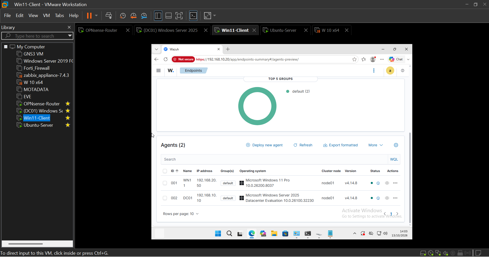
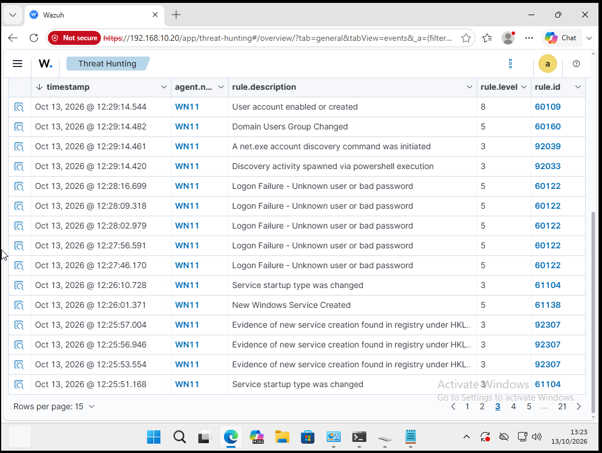
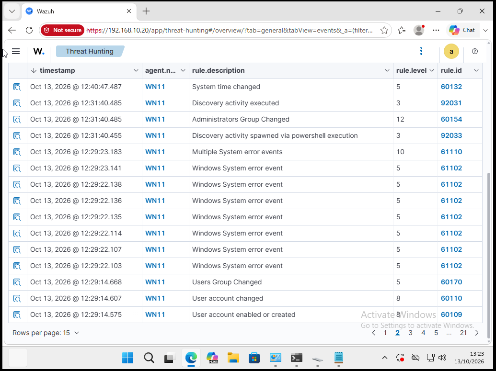
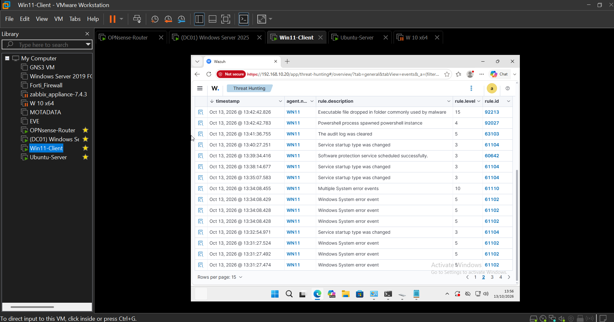
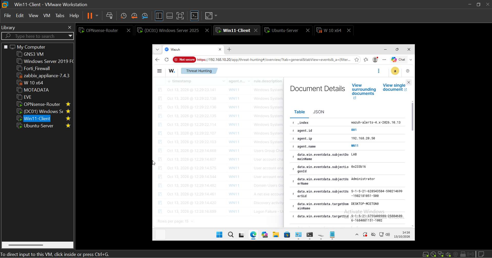
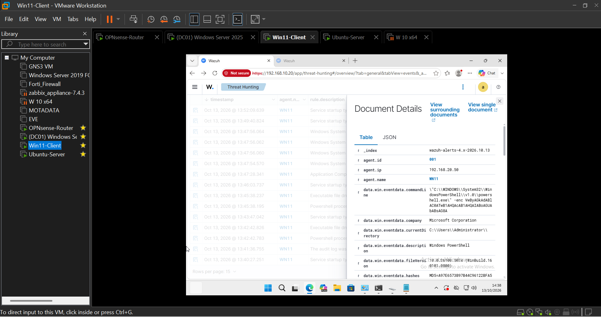
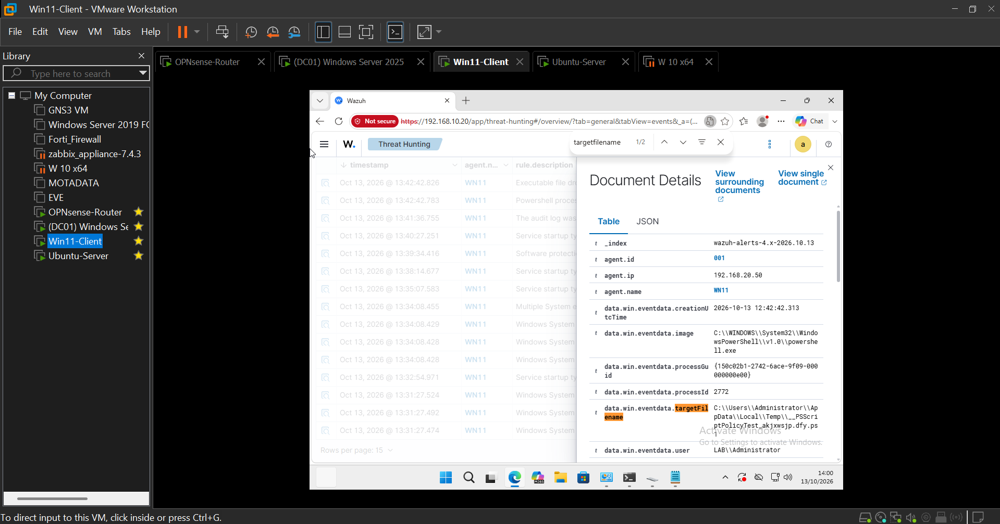

# Home SOC Lab

A virtual enterprise network built on one laptop to practise the full SOC (Security Operations Centre) workflow: build, collect logs, simulate attacks, detect and triage.

**Result: 5 of 5 simulated MITRE ATT&CK techniques detected by the Wazuh SIEM.**

📄 Full write-up: [Home-SOC-Lab-Write-up.pdf](docs/Home-SOC-Lab-Write-up.pdf)

## Lab at a glance

| Machine | Role | OS | IP address |
| --- | --- | --- | --- |
| OPNsense-Router | Firewall, router, NAT to the internet | OPNsense | LAN 192.168.10.1 and 192.168.20.1 |
| DC01 | Domain controller and DNS for `lab.local` | Windows Server 2025 | 192.168.10.10 |
| Ubuntu-Server | Wazuh SIEM (indexer, manager, dashboard) | Ubuntu Server | 192.168.10.20 |
| Win11-Client | Domain-joined client, Wazuh agent `WN11` | Windows 11 Pro | 192.168.20.50 |

DC01 and Win11 run a Wazuh agent and Sysmon (SwiftOnSecurity config). The agents send Windows and Sysmon events to the Wazuh manager, and alerts are reviewed in the Wazuh dashboard.

**Tools:** VMware Workstation · OPNsense · Windows Server 2025 (Active Directory) · Windows 11 · Ubuntu Server · Wazuh 4.14.8 · Sysmon · PowerShell

## Detection results

Tests ran on the Windows 11 client on 13 October 2026.

| # | Technique | MITRE ID | Wazuh alert (rule, level) | Result |
| --- | --- | --- | --- | --- |
| 1 | Brute force (5 failed logons) | T1110 | Logon Failure (60122, L5) | Detected |
| 2 | Create local account | T1136.001 | User account enabled or created (60109, L8) | Detected |
| 3 | Add account to Administrators | T1098 | Administrators Group Changed (60154, L12) | Detected |
| 4 | Clear the Security event log | T1070.001 | The audit log was cleared (63103, L5) | Detected |
| 5 | Encoded PowerShell command | T1059.001 | PowerShell process spawned PowerShell instance (92027, L4) | Detected |

## Key findings

- **Detection nuance:** the encoded PowerShell test was caught because PowerShell started another PowerShell process, not because of the encoding. Recommended a custom rule for encoded commands.
- **False-positive triage:** a level 15 "executable dropped in malware folder" alert was traced to PowerShell's own `__PSScriptPolicyTest_` temp file, created by the test itself. Recommended tuning the rule.
- **Central logging works:** after the Security log was cleared on the client, Wazuh still held every earlier event.

## Troubleshooting highlights

- Firewall boot time cut from **~60 minutes to under 2** by tracing configuration-service failures to a corrupted system file after host crashes, then restoring it from backup.
- Wazuh install fixed across three separate causes: slow link (pre-downloaded packages), half-allocated disk (LVM volume extended live) and leftovers from a failed install.
- Domain trust repaired after the client's computer account went missing from Active Directory.

The full troubleshooting log is in the [write-up](docs/Home-SOC-Lab-Write-up.pdf).

## Screenshots

| | |
| --- | --- |
|  |  |
| Both agents active | Five failed logons detected |
|  |  |
| Administrators group change (level 12) | Audit log cleared, PowerShell and level 15 alerts |
|  |  |
| Account creation, expanded | Full encoded command line captured |
|  | |
| False-positive evidence | |

## Next steps

- Write a custom Wazuh rule for encoded PowerShell and re-test.
- Tune the level 15 rule to ignore PowerShell's policy-test file.
- Enlarge the SIEM disk and re-enable vulnerability detection.
- Forward OPNsense firewall logs to Wazuh.

---
Built by Akinloluwa Euba · October 2026
